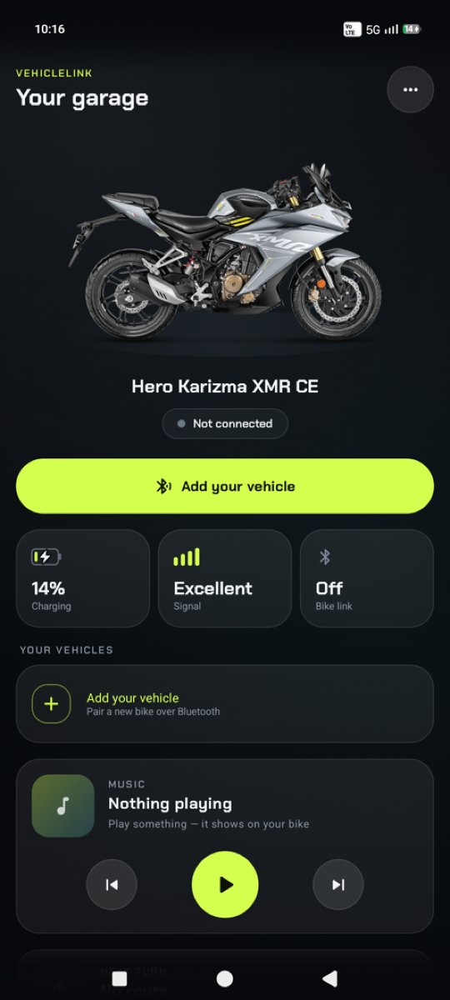
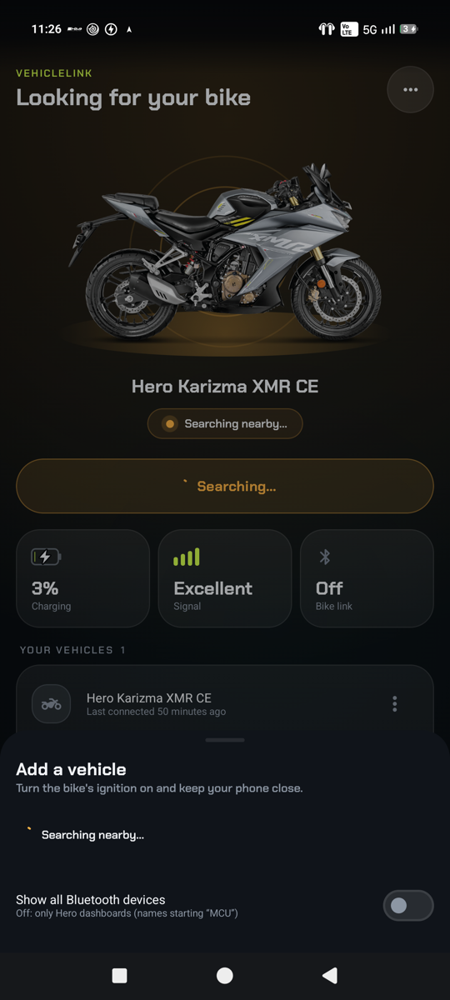
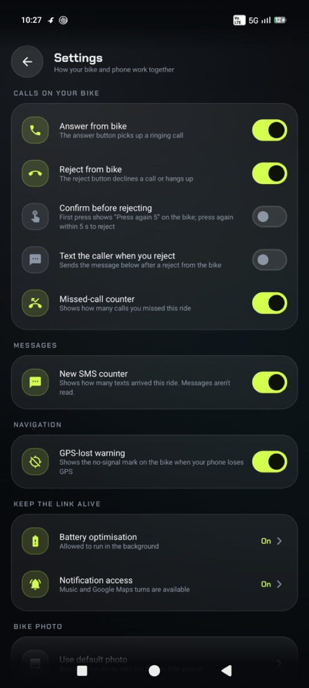
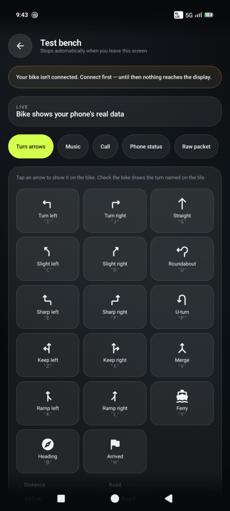
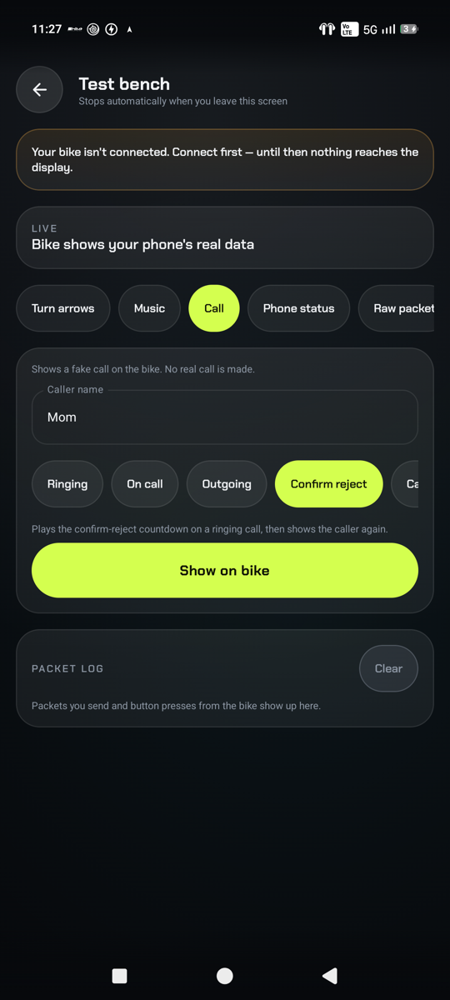
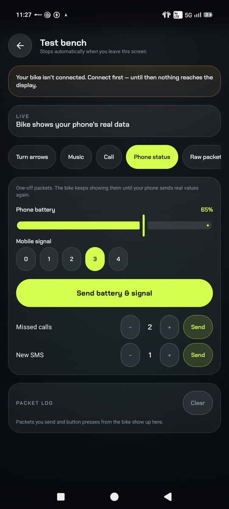

# VehicleLink

A lean Android companion app for **Hero motorcycles with a Bluetooth TFT display**. It talks to the
bike's dashboard over Bluetooth Low Energy and shows your calls, music, Google Maps turn-by-turn
directions and phone status on it, without the account, cloud services and analytics of the official app.

> **Supported bikes:** Hero models with a connected TFT dashboard, which all use the same Bluetooth
> dashboard protocol. Developed on the **Karizma XMR CE**; other models haven't been tried yet,
> and some get a reduced feature set from Hero (for example no call screen), so reports are welcome.

> **No release yet.** The app is still in development and not finished, so there's no APK download or
> GitHub release. To try it, build it from source (see [Build and install](#build-and-install)).

The cluster protocol was worked out by studying the official Hero app (see
[docs/original-app-analysis.md](docs/original-app-analysis.md)); VehicleLink re-implements the same
behaviour and packet formats in its own code.

> Not affiliated with, endorsed by or supported by Hero MotoCorp. Built for personal use and
> interoperability with a bike you own. Use at your own risk; don't operate the app while riding.

<p align="center">
  
  &nbsp;
  
  &nbsp;
  
</p>
<p align="center"><sub>Home (waiting for the bike to power on) · Adding a vehicle · Settings</sub></p>

## Features

**On the bike's display**
- **Turn-by-turn navigation** from the Google Maps app on your phone: the next turn arrow, distance,
  road name, arrival time and distance left. The arrow letters match the official app's table, and the
  bike keeps showing directions while you're stopped. A final "arrived" or "cancelled" packet clears it.
- **GPS-lost warning** while navigating: the cluster's no-signal mark appears when your phone's GPS is off,
  Google Maps is searching for GPS, or there's been no fix for more than 10 seconds.
- **Calls**: caller name for incoming calls, a running timer for ongoing and outgoing calls, and a
  "call ended" packet when you hang up.
- **Music**: song, artist, play/pause state, volume and a live progress bar for whatever app is playing
  (Spotify, YouTube Music, …).
- **Phone status**: battery level and mobile signal bars.
- **Missed-call and SMS counters** for the current ride. Only the count of messages is used; their
  contents are never read.

**From the bike's handlebar buttons**
- Answer and reject calls (each can be switched off).
- Optional **confirm before rejecting**: the first press shows `Press again 5` counting down on the bike;
  only a second press within 5 seconds rejects the call.
- Optional **text the caller** with your own message after rejecting from the bike.
- Play/pause, next and previous track, music and call volume.

**In the app**
- **Your vehicles**: every bike you've connected to, with rename and forget. New bikes are added from a
  pop-up sheet that searches nearby, explains what to do when nothing is found, and handles Bluetooth
  being off.
- **Automatic reconnect**: if the bike is switched off or goes out of range, the app keeps watching for it
  and reconnects about 2 seconds after it powers back up, the same way the official app does.
- **Quick Settings tile** and a **Turn off** button on the notification to switch the link on and off.
- **Test bench** for checking the bike's display without a real call, song or route: every turn arrow,
  music, calls (including the confirm-reject countdown), battery/signal and counters, plus a raw packet
  sender and a packet log. Everything stops as soon as you leave the screen.
- Dark "cockpit" design with animated states, the Chakra Petch display font, and a charging indicator.

<p align="center">
  
  &nbsp;
  
  &nbsp;
  
</p>
<p align="center"><sub>Test bench: turn arrows · calls and confirm-reject · phone status and counters</sub></p>

## Status

| Area | State |
|---|---|
| BLE connection, handshake, reconnect | Implemented to match the official app; reconnect after a bike power-cycle **not yet tested on the bike** |
| Music packet | Confirmed working on the bike earlier; progress-bar fix not yet re-tested on the bike |
| Calls, counters, GPS flag, navigation arrows | Packet formats verified offline against the official app's code; **not yet tested on the bike** |
| Google Maps parsing | Checked against a real Google Maps navigation notification (English, Oct 2026) |
| What each arrow letter draws on the cluster | Unknown until checked with the Test bench |

Open questions and anything inferred rather than seen are listed in
[docs/original-app-analysis.md §11](docs/original-app-analysis.md).

## How it works

```
 Google Maps notification ─┐
 Media sessions ───────────┤                               BLE (Telit TIO UART, MTU 65)
 Phone calls / SMS ────────┼──► VehicleBus ──► BleVehicleService ─────────────────────────► Cluster
 Battery / signal ─────────┘        ▲              │  ▲                                        │
                                    │              │  └── handlebar buttons (notify) ◄─────────┘
                            Compose UI ◄───────────┘
```

- **Connection**: the cluster advertises as `MCU…` and exposes a Telit TIO serial-over-BLE service
  (`e837d9a2-9c49-4493-9547-8e6918a59ca8`). After connecting, the app discovers services, requests an
  MTU of 65, enables the credit and data channels, grants 10 credits, then starts sending.
- **Packets** are short ASCII strings wrapped in `\n…\n`. The first character is the type:
  `9` music, `7` call, `1` navigation, `3` battery/signal, `5` missed calls, `6` SMS.
  A sender loop runs every 800 ms, like the official app.
- **Turn-by-turn** comes from Google Maps' own ongoing navigation notification (read with notification
  access), so there's no routing in the app and no Maps API cost.

Full details: [PROTOCOL.md](PROTOCOL.md) and [docs/original-app-analysis.md](docs/original-app-analysis.md).

## Build and install

Requirements: Android Studio (Koala or newer) or Gradle 8.9 with **JDK 17–21**, Android SDK 34.
The app runs on Android 8.0+ and has been used on Android 17.

```bash
cp local.properties.sample local.properties   # then set sdk.dir (and optionally MAPS_API_KEY)
gradle :app:assembleDebug
adb install -r app/build/outputs/apk/debug/app-debug.apk
```

There is no Gradle wrapper script in the repo yet; open the project in Android Studio or use a local
Gradle 8.9. `MAPS_API_KEY` (Maps SDK for Android) is only needed for the optional in-app map card;
turn-by-turn on the bike works without it.

## First run

1. Allow the permissions the app asks for (nearby devices, phone, contacts, call log, notifications, SMS).
2. **Notification access** (Settings → Notification access): needed for music and Google Maps directions.
3. **Battery optimisation** (the "Keep the bike link alive" card): lets the link survive in the background.
4. Switch the bike's ignition on, tap **Add your vehicle**, and pick your bike (it shows as "Hero bike
   dashboard"). It's saved to **Your vehicles** once connected.
5. Optional: add the **VehicleLink** tile to Quick Settings.

## Permissions

| Permission | Used for |
|---|---|
| Nearby devices (Bluetooth scan/connect), location on Android ≤ 11 | Finding and connecting to the bike |
| Foreground service (connected device, location) | Keeping the link alive; watching GPS while navigating |
| Phone state, call log, contacts | Caller name and call state for the bike |
| Answer phone calls | Answer / reject from the handlebar |
| Receive SMS | New-SMS counter (count only) |
| Send SMS | Optional "text the caller when you reject" (off by default) |
| Notification access | Google Maps directions and music control |
| Ignore battery optimisations | Optional, asked from the app |

## Project structure

| Path | What's there |
|---|---|
| `app/.../ble/BleVehicleService.kt` | Foreground service: scan, connect, TIO handshake, reconnect, 800 ms sender, handlebar commands |
| `app/.../ble/VehicleLinkTileService.kt` | Quick Settings on/off tile |
| `app/.../core/ClusterProtocol.kt` | Builds every cluster packet (music, call, navigation, status, counters) |
| `app/.../core/VehicleBus.kt` | In-memory state shared between the service, receivers and UI |
| `app/.../core/AppSettings.kt`, `VehicleStore.kt` | User settings and saved vehicles |
| `app/.../nav/MapsNavParser.kt` | Reads Google Maps' navigation notification |
| `app/.../media/MediaHub.kt` | Active media session: track info and transport controls |
| `app/.../phone/CallReceiver.kt`, `SmsReceiver.kt` | Call state, missed calls, SMS count |
| `app/.../ui/` | Compose UI: home, vehicles and add sheet (`Garage.kt`), settings, test bench, theme |
| `firmware/esp32_vehiclelink.ino` | Reference ESP32 peripheral for bench testing (older line protocol) |
| `docs/` | Protocol analysis of the official app, screenshots, licences |

## Credits

- Built with the help of [Claude](https://www.anthropic.com/claude) (Anthropic), used as a coding
  assistant for the protocol analysis, the app code and the documentation.
- Display font: [Chakra Petch](https://github.com/m4rc1e/Chakra-Petch) by Cadson Demak, SIL Open Font
  License 1.1 ([licence](docs/licenses/ChakraPetch-OFL.txt)).
