# Original Hero app — vehicle connectivity analysis

**Target:** `base.apk` — `com.customerapp.hero` v10.1.06 (versionCode 91105), minSdk 28, targetSdk 36.
**Method:** static decompilation with jadx 1.5.6 into `../_decompiled/base` (outside this source tree),
plus the decoded manifest in `../_rea/manifest.txt`. Nothing here was observed at runtime.
**Out of scope:** map / navigation (packet type `1`) is not re-analysed here; see `PROTOCOL.md`.

Legend: **[seen]** = read directly in decompiled code · **[inferred]** = reasoning on top of
what was seen · anything uncertain is repeated in *Unknowns* at the end.

Class names below are relative to `com.customerapp.hero` unless they start with another package.

---

## 1. Architecture overview

```
 DashboardWrapper (thorwrapper/rideguidewrapper)        ← feature brain, lives with the dashboard UI
   ├─ PhoneStateReceiver   (ride_guide/receiver)  PHONE_STATE broadcast → onPhoneStateChangeListener
   ├─ BatteryLevelReciever (ride_guide/receiver)  BATTERY_CHANGED       → onBatteryLevelChangeListener
   ├─ PhoneStateListener   (inline, LISTEN_SIGNAL_STRENGTHS = 256)      → onSignalStrengthsChanged
   ├─ BluetoothStatusChangeReceiver               adapter STATE_CHANGED → onBluetoothStatusChanged
   ├─ NotificationListener (otc/service) + com.nativelib.otc.music.*    → onMetadataChange / onPlaybackStateChange / onCurrentPositionChange
   └─ SendDataToCluster (views/fragments/rideGuide, singleton)          ← builds every packet
            │ sendData(mac, bytes) / sendMusicDurationData(mac, bytes)
            ▼
 BluetoothConnectionService (ride_guide)  foreground service, id 1001, type connectedDevice(16)
   ├─ BluetoothConnectionService$bluetoothGattCallback$1  ← GATT callback, TIO handshake, inbound buttons
   ├─ ...$onConnectionStateChange$2 / $3                  ← delayed discoverServices, 5 s bond-poll loop
   ├─ BondStateReceiver (BOND_STATE_CHANGED)              ← only reports bonding progress to UI
   └─ reScanForAutoConnect(mac) + bleScanCallback          ← auto-reconnect
```

Every packet goes to one characteristic (Data-RX) with the characteristic's default write type.
`SendDataToCluster` keeps no queue: features write independently, mostly from `Handler`/`Timer` callbacks.

### Connection state diagram

```mermaid
stateDiagram-v2
    [*] --> Idle
    Idle --> Connecting: connect(mac) → connectGatt(autoConnect=false)
    Connecting --> Connected_Link: STATE_CONNECTED
    Connected_Link --> Discovering: +1000 ms discoverServices()
    Discovering --> MtuRequest: onServicesDiscovered, service matched (serviceTypeValidation)
    MtuRequest --> CreditsIndicate: onMtuChanged(status 0) → CCCD 0x0200 on Credits-TX
    CreditsIndicate --> DataNotify: onDescriptorWrite(Credits-TX) → CCCD 0x0100 on Data-TX
    DataNotify --> InitialCredits: onDescriptorWrite(Data-TX) → write uint8 10 to Credits-RX
    InitialCredits --> UartConnected: onCharacteristicWrite(Credits-RX) && bonded  /  inbound byte 53 ('5')
    UartConnected --> Disconnected: STATE_DISCONNECTED (bike off, out of range)
    Connecting --> Disconnected: connect timeout / GATT error
    Disconnected --> ReScan: gatt.close(); !disConnectionTriggerByUser
    ReScan --> Connecting: scan hit for saved MAC → stopScan → +2000 ms connect()
    Disconnected --> Idle: user disconnect (disConnectionTriggerByUser = true)
    UartConnected --> Idle: Bluetooth adapter OFF → disconnectCluster()
    Idle --> Connecting: Bluetooth adapter ON → makeClusterConnection()
```



---

## 2. GATT services and characteristics

| Role | UUID | Properties / use | Source |
|---|---|---|---|
| Cluster service (Karizma XMR) | `e837d9a2-9c49-4493-9547-8e6918a59ca8` | matched in `serviceTypeValidation` | `…$bluetoothGattCallback$1.serviceTypeValidation` [seen] |
| Data-RX (phone → cluster) | `64aecb40-849a-44f1-934f-addc4b316423` | every app packet (`B0.d`) | same [seen] |
| Credits-RX (phone → cluster) | `f535dd6e-7975-4abd-9719-491e38a81179` | uint8 `10` once after handshake (`B0.a`) | same + `onDescriptorWrite` [seen] |
| Data-TX (cluster → phone) | `b792a4bb-db87-436a-9066-db63c5fb3f00` | notify, CCCD `01 00` (`B0.c`) | same [seen] |
| Credits-TX (cluster → phone) | `36e8614b-2ded-45c1-9ad3-c9f59a01f21e` | indicate, CCCD `02 00` (`B0.b`) | same [seen] |
| Alt. Telit TIO service | `0000fefb-0000-1000-8000-00805f9b34fb` | RX `…0001`, TX `…0002`, RX-credits `…0003`, TX-credits `…0004` on base `-0000-1000-8000-008025000000` | `BluetoothConnectionService` constants [seen]; not used by this bike [inferred] |
| CCCD | `00002902-0000-1000-8000-00805f9b34fb` | | [seen] |

Requested MTU: **65** (`mtuSize = 65`, `requestMtu` validates 23..517) [seen].

---

## 3. Connection lifecycle

**Scan / pair.** First-time pairing happens in a separate onboarding flow (`BluetoothScanService` fragment)
which stores `SaveNdConnectVdsMapping{vdsCode, bleName, macAddress, nickName}` in prefs key `local` [seen].
The app **never calls `createBond()`** (searched `com.customerapp`, `com.nativelib`, `com.bleFeatures`) [seen];
it only watches `BOND_STATE_CHANGED` to show progress (`BondStateReceiver`). Bonding, if it happens, is
initiated by the cluster's security request [inferred].

**Connect.** `BluetoothConnectionService.connect(mac, from)` [seen]:
1. reset flags, `close()` any previous `BluetoothGatt`;
2. bail out if the adapter is off;
3. `device.connectGatt(this, autoConnect = false, callback)` (default transport) and `connectionState = 1`.

**After STATE_CONNECTED** (`onConnectionStateChange`, `…$onConnectionStateChange$2/$3`) [seen]:
- If not bonded: coroutine waits **1000 ms** then `discoverServices()` (guarded by `servicesRequested`).
- If bonded: the 5 s loop (`$3`) also triggers a 1000 ms-delayed `discoverServices()` and marks the link
  CONNECTED. The loop re-runs every **5000 ms** until `cancelRepetitionCall()`.

**Discovery → MTU → TIO handshake** [seen]:
1. `onServicesDiscovered(status 0)` → first matching service → `requestMtu(65)`.
2. `onMtuChanged(status 0)` → `setCharacteristicNotification` + write CCCD `ENABLE_INDICATION` on **Credits-TX**;
   `tioState = UART_CREDITS_TX_INDICATION`. (If MTU status ≠ 0 nothing further happens.)
3. `onDescriptorWrite` for Credits-TX with indication value, state `UART_CREDITS_TX_INDICATION` →
   enable **notify** on **Data-TX**; state `UART_DATA_TX_NOTIFY`.
4. `onDescriptorWrite` for Data-TX with notify value → `sendIntData(Credits-RX, 10)` (`setValue(10, FORMAT_UINT8)`);
   state `UART_INITIAL_CREDITS`.
5. `onCharacteristicWrite` on Credits-RX: if bonded and `isConnectedAndBonded` → `UART_CONNECTED`, broadcast
   `ACTION_GATT_CONNECTED`.
   Independently, an inbound byte **53** (`'5'`) at index 2 also forces `UART_CONNECTED` (keep-alive / "I'm here").

Credits are granted **once** (10). The periodic `autoUpdateNotificationCredit` only resets a counter; it
does not write more credits [seen].

**Disconnect** (`newState == 0`) [seen]: clear all flags, `lastSentData = 0`, broadcast DISCONNECTED,
`gatt.close()`, `mBluetoothGatt = null`, then **if not user-triggered → `reScanForAutoConnect(lastMac)`**.

**User disconnect** `disConnectDevice(from, byUser=true)`: sets `disConnectionTriggerByUser`, calls
`gatt.disconnect()` (close happens in the callback) [seen].

---

## 4. Auto-reconnect

| Aspect | Original behaviour | Source |
|---|---|---|
| Trigger | every `STATE_DISCONNECTED` that was not user-initiated | `onConnectionStateChange` [seen] |
| Mechanism | **BLE scan filtered by the saved MAC** (`ScanFilter.setDeviceAddress`) | `reScanForAutoConnect`, `getMacAddressFilter` [seen] |
| Scan settings | mode `2` LOW_LATENCY, callbackType `1` ALL_MATCHES, matchMode `1` AGGRESSIVE, numMatches `3`, legacy `true`, phy `255` ALL, reportDelay `0` | `getScanSetting$default` [seen] |
| Scan timeout | **none** — runs until a result arrives (or the service dies) | [seen: no stop/timer] |
| On result | name equals saved `bleName` → `stopScan` → `connectBle(mac)` → **2000 ms** delay → `connect(mac)` | `bleScanCallback.onScanResult`, `connectBle` [seen] |
| GATT `autoConnect` | `false` | `connect()` [seen] |
| Retry when connect fails | a failed attempt arrives as another `STATE_DISCONNECTED` → scan again (loop) | [inferred from the above] |
| Adapter OFF | `onBluetoothStatusChanged(false)` → `disconnectCluster(ctx, byUser=false)` | `DashboardWrapper` + `BluetoothStatusChangeReceiver` [seen] |
| Adapter ON | `onBluetoothStatusChanged(true)` → `makeClusterConnection()` → `connect(savedMac)` | [seen] |
| Survives background | `BluetoothConnectionService` is a **foreground service** (`startForeground(1001, …)`, type `connectedDevice`), plus `AppMonitoringService`. No WorkManager. `onStartCommand` returns `START_NOT_STICKY` (2); `onTaskRemoved` stops it | [seen] |
| Backoff | none besides the fixed 2 s pre-connect delay; scanning itself is the wait | [seen] |

Explanation of the design [inferred]: while the bike is off it is not advertising, so the filtered scan simply
waits; the moment the cluster powers up and advertises, the scan fires and the app connects. A plain
`connectGatt(autoConnect=false)` retry instead times out after ~30 s and gives up.

---

## 5. Packet framing (all features)

Each packet is ASCII, built as `"\n" + body + "\n"` and written to **Data-RX**. The first body char is the
packet type [seen]. Field padding uses `padString(str, n)` / `utils.c.a.a(str, n)`, which **append `~` until the
string is `n + 1` chars long** — the loop appends one `~` per index from `len` to `n` inclusive [seen]. So
`padString(x, 17)` is **18** chars and `padString("~", 5)` is **6** chars. (The music fields use a
different loop that pads to exactly 20.)

| Type | Meaning | Body length | Wrapped |
|---|---|---|---|
| `9` | music | 46 | 48 |
| `7` | call (ringing / active / outgoing / none) | 46 | 48 |
| `3` | phone battery + network (+ user name) | 21 | 23 |
| `5` | missed-call count | 3 | 5 |
| `6` | SMS count (`"60" + n`) | 2+ | — |
| `1` | navigation (out of scope) | 48 | 50 |

---

## 6. Music

**Sources** [seen]: `otc/service/NotificationListener` (NotificationListenerService) gives access to
`MediaSessionManager`; `com.nativelib.otc.music.*` / `com.bleFeatures.music.g` wrap the active
`MediaController` and call back into `DashboardWrapper` (`onMetadataChange`, `onPlaybackStateChange`,
`onCurrentPositionChange` every ~1 s, `onCurrentSessionDestroyed`).

**Packet** (`SendDataToCluster.getMusicData`) [seen]:

```
\n 9 <song[20]> <artist[20]> 0 <0|1> <play> <prog> <vol> \n      = 48 bytes
offset 0 '\n', 1 '9', 2..21 song, 22..41 artist, 42 '0', 43 '0' ('1' when the session is destroyed),
       44 play, 45 prog, 46 vol, 47 '\n'
```
- song/artist: `keepSafeAscii` **removes** every char not in `[A-Za-z0-9 +\-._]`, then truncate to 20 or pad
  with `~` to 20. Missing → `Unknown~~~~~~~~~~~~~`.
- artist = metadata artist, else album [seen in `onMetadataChange`: `str2 ?: str3`].
- play: `"0"` when `AudioManager.isMusicActive()`, else `"1"`; overridden by the explicit value on play/pause events.
- prog: **percent played, 0..100, sent as a raw byte** at offset 45. `com.bleFeatures.music.e` (1 s
  timer, only while `isMusicActive()`) computes `getPlaybackState().getPosition() * 100 / duration` and calls
  `onCurrentPositionChange(percent)` when it changes. `getMusicData` writes values > 31 as `(char) percent`;
  values ≤ 31 are first written as `'d'`, then `sendMusicDurationData` overwrites byte 45 with the raw value
  (the 1..31 `switch` there is an identity map, not a 31-step scale). Unknown duration → `'d'` (= 100) [seen].
- vol (`ContextExtKt.O`, from `STREAM_MUSIC` % ): `1–5 d`, `6–10 e`, `11–15 f`, `16–40 g`, `41–50 h`,
  `51–60 i`, `61–70 j`, `71–80 k`, `81–90 l`, `91–95 m`, `96–100 n`, `0 → d` [seen].
- Session destroyed: songs `""` → `Unknown~…`, `"01"`, play `"0"` [seen].

**Timing:** event-driven (metadata change, play/pause, battery change, position tick ≈ 1 Hz) — no fixed loop.

**Controls from the bike** (`onCharacteristicChanged`, value index 2) [seen]:

| Byte @2 | Char | Action |
|---|---|---|
| 35 | `#` | play/pause: `dispatchMediaKeyEvent(KEYCODE_MEDIA_PLAY 126 / PAUSE 127)` based on `isMusicActive()`, then resend music packet |
| 40 | `(` | `transportControls.skipToNext()` |
| 45 | `-` | `transportControls.skipToPrevious()` |
| 50 | `2` | toggle mute `STREAM_MUSIC`, resend music packet |
| 65 | `A` | `STREAM_MUSIC` volume up, resend music packet |
| 70 | `F` | `STREAM_MUSIC` volume down (only while music active), resend music packet |

---

## 7. Calls

**Detection** [seen]: runtime-registered `PhoneStateReceiver` for `android.intent.action.PHONE_STATE`
(`DashboardWrapper.registerPhoneStateReceiver`). No `TelephonyCallback` for call state.
- Reads `EXTRA_STATE` and `incoming_number`; keeps the **last 10 digits**.
- **Returns early when the number is empty.** On Android 9+ the broadcast is delivered twice and only the copy
  sent to apps holding `READ_CALL_LOG` carries the number — so the original effectively ignores the number-less copy.
- Name: `ContactsContract.PhoneLookup` → display name, **`"Unknown"`** if no contact (needs `READ_CONTACTS`).
- Maps to `"ring"` / `"hook"` (OFFHOOK) / `"idle"`.

**State machine** (`DashboardWrapper.onPhoneStateChangeListener`, feature type `CommonFeatureMusic`) [seen]:
- `ring` (first time, no active call) → `sendRingingData` = ringing packet **every 1 s** on a
  `ScheduledExecutorService` until cancelled.
- `hook` → `onMusicFeatureCallPick`: stop ringing, start a 1 s `Timer`:
  - had rung (`ring == true`) → **active** packet (state `2`) with the running time,
  - no ring before → **outgoing** packet (state `4`).
- `idle` → `onCallReject`: cancel timer/executor, send missed-call packet if it rang but was never picked,
  then send the **no-active-call** packet once.

**Packets** (`SendDataToCluster`) — all 48 bytes wrapped [seen]:

```
name18 = clean(name, keep [A-Za-z0-9 ]) → cut to 17 → pad with '~' to 18
time6  = "0" + String.format("%d%02d%02d", h, m, s)      e.g. 1 m 05 s → "000105"
vol    = ContextExtKt.O(STREAM_VOICE_CALL %)               (table in §6)

ringing   \n 7 name18 1 ~×18   0 ~×6   d   \n
active    \n 7 name18 2 name18 0 time6 vol \n
outgoing  \n 7 name18 4 name18 0 time6 d   \n
no call   \n 7 ~×18   0 ~×18   0 ~×6   d   \n
missed    \n 5 NN \n            (NN = 2-digit count, sent 1 s later)
```

**Answer / reject from the bike** (inbound byte @2) [seen]:
- **10** → `TelecomManager.acceptRingingCall()` if `ANSWER_PHONE_CALLS` granted.
- **15** → `TelecomManager.endCall()` if `READ_PHONE_STATE` granted and `isInCall()`.
- `7` / `<` (55 / 60) → `STREAM_VOICE_CALL` volume up / down while a call is up, then resend an active packet.

Note: the non-music feature types (`Navigation`, `CommonFeatures`) send `\n2<number>\n` instead of the type-7
packet [seen]. The Karizma XMR uses the music feature set, because its music packet (type 9) is
confirmed working [inferred].

---

## 8. Phone battery and network signal (packet type 3)

**Sources** [seen]:
- Battery: `BatteryLevelReciever` on `Intent.ACTION_BATTERY_CHANGED` → `level * 100 / scale`.
- Signal: `TelephonyManager.listen(PhoneStateListener, LISTEN_SIGNAL_STRENGTHS=256)` →
  `SignalStrength.getLevel()` (reflection) → **0..4**, sent as one digit.

**Packet** (`sendBatteryNetworkData`, feature `CommonFeatureMusic`) [seen]:

```
\n 3 <batt> <signal> <name18> \n        = 23 bytes
batt  : 0–20 → '0', 21–39 → '1', 40–59 → '2', 60–79 → '3', ≥80 → '4'
signal: '0'..'4'  (SignalStrength level)
name18: user profile name, cut to 15, padded with '~' to 18
```

**When / how often** [seen]: on every battery change, every signal-strength change, after a call ends
(`onPhoneStateChangeListener$lambda$5`) and on connect (`sendInitialDataToCluster`). Each trigger posts the
same packet **twice: after 2000 ms and after 5000 ms**. Sending is skipped while not connected.

A separate low-battery packet `\n3<batt>\n` exists (`sendLowBatteryData`, levels 20/10/8/6/4/2) but has no
caller in this build [seen].

---

## 9. Other vehicle-connected features found

| Feature | Packet / behaviour | Source |
|---|---|---|
| Missed-call counter | `\n5NN\n`, 1 s after a ring that ended unanswered | `sendMissCallData` [seen] |
| SMS counter | `\n60<n>\n` on `SMS_RECEIVED` | `sendSMSData`, `registerSmsReceiver` [seen] |
| Keep-alive / connected | inbound byte 53 (`'5'`) marks the link connected | GATT callback [seen] |
| DND / ringer mode | `RINGER_MODE_CHANGED` receiver, smart-mode auto-SMS | `registerAudioModeChangeReceiver`, `AutoSmsSenderService` [seen; not traced further] |
| Navigation | packet type `1` | out of scope |

No time-sync packet was found [bounded: searched `SendDataToCluster` and the GATT callback only].

---

## 10. Permissions, components and Android versions

Relevant manifest entries of the original [seen in `_rea/manifest.txt`]:
- BLE: `BLUETOOTH` (≤30), `BLUETOOTH_ADMIN`, `BLUETOOTH_SCAN`, `BLUETOOTH_CONNECT`, `BLUETOOTH_ADVERTISE`,
  `ACCESS_FINE_LOCATION` / `ACCESS_COARSE_LOCATION` (scanning ≤ Android 11).
- Service: `FOREGROUND_SERVICE`, `FOREGROUND_SERVICE_CONNECTED_DEVICE`;
  `BluetoothConnectionService` `foregroundServiceType="16"` (connectedDevice), `AppMonitoringService` (16, `stopWithTask=false`).
- Calls: `READ_PHONE_STATE`, `READ_CALL_LOG` (number in PHONE_STATE on 9+), `READ_CONTACTS`,
  `ANSWER_PHONE_CALLS`, `CALL_PHONE`, `READ_PHONE_NUMBERS`, `MODIFY_AUDIO_SETTINGS`.
- Music: `NotificationListener` service with `BIND_NOTIFICATION_LISTENER_SERVICE` (user grants notification access).
- Notifications: `POST_NOTIFICATIONS` (13+) for the foreground notification.
- SMS: `RECEIVE_SMS`, `READ_SMS`, `SEND_SMS`.
- `REQUEST_IGNORE_BATTERY_OPTIMIZATIONS`, `WAKE_LOCK` (a 5 s wake-lock ping after each characteristic write).

Version notes: on 12+ every GATT/scan call checks `BLUETOOTH_CONNECT`/`BLUETOOTH_SCAN` first [seen];
on 9+ the caller number needs `READ_CALL_LOG`; on 13+ the foreground notification needs `POST_NOTIFICATIONS`.

---

## 11. Unknowns / needs runtime verification

1. **Bonding.** The app never calls `createBond()`, but it only declares the link fully connected when the
   device is bonded or the cluster sends byte 53. Whether the cluster requires encryption/bonding is unknown.
2. **Credits.** Credits are granted once (10). Whether the cluster replenishes on its own, or our periodic
   re-grant is harmful or harmless, is unverified.
3. **Write type.** The original uses the Data-RX characteristic's default write type; with a
   write-without-response-only characteristic that is no-response [inferred].
4. **Feature type.** The `VdsObject.featureType` comes from Hero's server. We assume `CommonFeatureMusic`
   for the Karizma XMR [inferred] — this selects the type-7 call packet and the 23-byte type-3 packet.
5. **Music progress.** Resolved: it is a 0..100 percentage (see §6). Note a 10 % position puts byte `0x0A`
   (`\n`) inside the packet; the original does the same, so the cluster evidently reads fixed offsets.
6. **Signal-strength cadence.** `onSignalStrengthsChanged` fires at the modem's pace; there is no fixed interval.
7. **The `'~'`-padding off-by-one** (18/6-char fields) is read from code, not from a capture. The resulting
   48-byte call packet matching the 48-byte music packet supports it [inferred].
8. **User-name field** in packet 3 comes from Hero's profile; what the cluster shows when it is all `~` is unknown.

## 12. Root causes in VehicleLink (Phase 3)

### Bug 1 — no reconnect after the bike is turned off and on
- `BleVehicleService.onConnectionStateChange` retries **once**, 2 s after a drop, with
  `connectGatt(autoConnect=false)`. With the bike still off, that attempt fails (typically status 133 after
  ~30 s). By then `cleanupGatt()` has cleared `clusterMode`, so `wasLinked` is false and **no further retry is
  scheduled**. Any power-off longer than a few seconds ends the link for good.
- There is no Bluetooth adapter on/off handling, and the target MAC lives only in memory, so a restarted
  (`START_STICKY`) service has nothing to reconnect to.
- The original instead keeps a **MAC-filtered scan running with no timeout** and connects 2 s after the bike
  advertises again, restarts on adapter ON, and stores the MAC.

### Bug 2 — incoming/ongoing call info not shown on the bike
- **Wrong field widths.** `ClusterProtocol.call` pads names to 17 and the duration to 5, giving a 45-byte
  packet. The original's fields are 18 / 18 / 6 (48 bytes). The cluster reads fixed offsets, so the state
  byte and everything after it land in the wrong place.
- **Wrong time format.** We send `MM:SS`, the original sends `"0" + H + MM + SS` (6 digits, no colon).
- **No "no active call" packet** on hang-up — the original sends one; we just switch back to music.
- **Outgoing calls** are sent as state `2` with the name `"In call"`; the original uses state `4` with the
  dialled contact/number.
- **Number-less duplicate PHONE_STATE broadcast** can overwrite the resolved name with `"Unknown"`
  (the original ignores broadcasts without a number).

### Bug 3 — music progress bar shows less than the real position (90 % shown as ~40 %)
- We sent progress as 1..31 steps (90 % → 28); the cluster expects a 0..100 percentage, so it drew ~28 %.
- `PlaybackState.position` was used raw. It is only the position at the player's last update, so between
  updates it lags; it must be advanced by `elapsedRealtime() - lastPositionUpdateTime` × speed.

### Deviations in music / battery / signal
- Music volume char boundaries are off by one (`5`→`e` vs original `d`, `10`→`f` vs `e`, …).
- Music text: we replace non-ASCII with `?`; the original removes anything outside `[A-Za-z0-9 +-._]`.
- `CP1252` constant is actually UTF-8 (harmless for the filtered ASCII, but misleading).
- **Battery % and signal bars are not sent at all** — packet type 3 is missing.

---

## 13. Navigation (packet type 1) — added after the first pass

**Sources** [seen]: `views/fragments/quickAction/NavigateFragment` (`sendDataToSpeedoMeter`, `setDirBinary`,
`updateNavigationData`, `startNavSender`, `handleNavigationFinished/Cancelled`, `getRoadName`,
`roundAboutExit`), `thorwrapper/rideguidewrapper/NavigationPacket.toPacketString`,
`com.mappls.sdk.plugin.directions.DirectionsUtils.getManeuverId`, the bundled
`translations/mappls-directions-en_short_instructions.json`, and `com.google.gson.internal.e.b` (roundabout IDs).
`setDirBinary` was re-decompiled with `jadx -m simple` because the default output mangled the string switch.

**Packet** (`"\n" + body + "\n"`, body 48 bytes) — field order unchanged from §5 / PROTOCOL.md.
For the music-feature cluster (`app_type` is always 191) the full form is sent [seen]:

| Field | Value |
|---|---|
| dir | maneuver letter (table below); **lower-case when < 200 m** to the turn |
| distance / unit | distance to the turn, `"00450"` + `1` (m) or `"001.2"` + `k` (`ContextExtKt.D`) |
| ETA | `hh` (12-hour) + **`a`/`p`** + `mm` + **`m`** — lower-case for this cluster |
| roundabout | exit `01`..`09` when the text has both "Nth" and "exit", else `00` |
| noSignal | `1` while GPS is lost, else `0` |
| remain dist / unit | trip remainder: ≤ 999 m `%05d` + `1`; else km `%05.1f` (`%05.0f` when whole) + `k` |
| remainTime | always `~~~~` |
| nextDir | always `~` |
| secondRoundabout | always **`04`** |
| road | current step name, `~`-padded to 18 (the original appends a 19th `~` when the name is > 18 chars — treated as a bug, we cut to 18) |

**Maneuver → letter** (Mappls maneuver ID from the short-instruction templates → `setDirBinary`) [seen]:

| Maneuver | ID | Letter |
|---|---|---|
| turn left / arrive left / end of road left | 0, 9, 13 | `I` |
| turn right / arrive right / end of road right | 3, 10, 14 | `J` |
| slight left / slight right | 2 / 5 | `C` / `D` |
| sharp left / sharp right (incl. fork sharp) | 1, 17 / 4, 18 | `E` / `F` |
| keep/fork left / keep/fork right | 15, 19 / 16, 20 | `Z` / `X` |
| straight, continue, arrive straight, fork/merge straight | 7, 8, 21, 32, 33 | `G` |
| merge (any side) | 26–31 | `V` |
| on/off ramp left (and unspecified) / right | 42, 44, 73, 74 / 43, 75 | `K` / `L` |
| U-turn | 41 | `P` |
| roundabout / rotary, left-hand traffic (exit by angle) | 65–72 (68 → `G`) | `U` |
| ferry | 36 | `Y` |
| compass heading (depart) / route recalculating | 51–57 / — | `B` |
| navigation finished / cancelled | — | `H` / `G` (one final packet, distance `00000`) |

**Timing** [seen]: a coroutine re-sends the latest packet **every 800 ms** while navigating
(`startNavSender`), whether or not anything changed; finish/cancel send one last packet (`sendOneNavPacket`).

### Root causes in VehicleLink (navigation)
- `ClusterProtocol.dirCode` used the wrong letters: left `C`, right `D`, straight `I`, roundabout `B`,
  U-turn `Z`, merge/ramp `V`. Most arrows on the bike were wrong.
- ETA was hard-coded `12A00M` (and upper-case); trip remainder was `~`; `secondRoundabout` was `00`.
- Navigation counted as stale 12 s after the last Maps update, so the bike fell back to music while stopped.
  The original keeps repeating the last packet until guidance ends.
- No final `H` / `G` packet when guidance ended.

### Google Maps notification (our input) — observed on the test phone, Oct 2026
`title "150 m · Turn left onto MG Road"`, `subText "Arrive 6:26 pm"`,
`ProgressStyle progress=2 / progressMax=11256` (metres travelled / trip length — **inferred** from 11.3 km
for a ~22-minute trip; not confirmed against Maps' own UI).

### Navigation unknowns
- Arrow letters are mapped by the original's logic; **what each letter draws on the cluster is not verified**.
- Google Maps wording varies by locale and version; only English was observed. Unknown wordings fall back to `G`.
- No-signal (`1`) is never sent: the Maps notification gives no GPS-lost signal.
- If notification access is revoked mid-route we never see the removal, so no final packet is sent.
